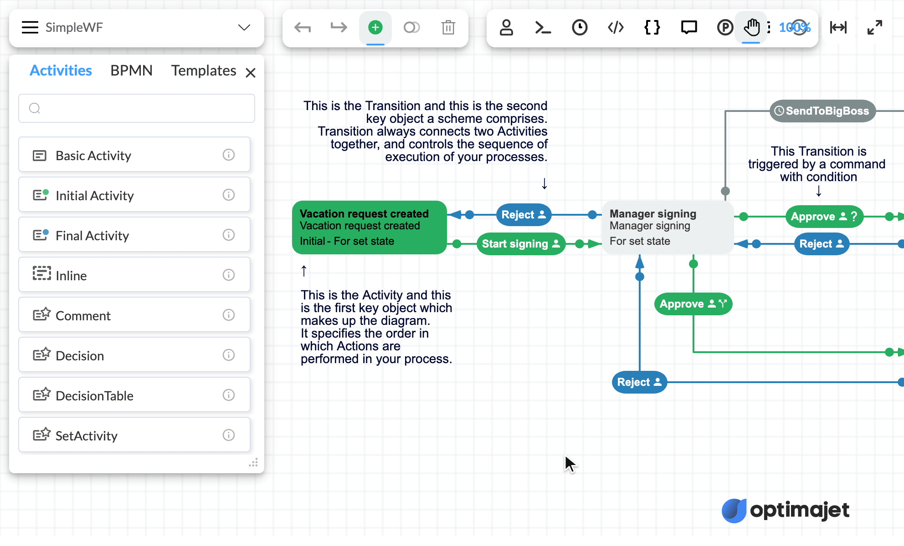

# Workflow Engine by Optimajet

[](https://www.nuget.org/packages/WorkflowEngine.NETCore-Core/)
[](https://www.nuget.org/packages/WorkflowEngine.NETCore-Core/)
[](https://github.com/optimajet/WorkflowEngine.NET)
[](https://docs.workflowengine.io/)

**Workflow Engine by Optimajet is an embeddable workflow engine for .NET and C# applications.** It adds approvals, state machines and long-running business processes to your own app, with a visual Workflow Designer that developers and business users open in the browser. It installs from NuGet as `WorkflowEngine.NETCore-Core`, runs inside your process with no separate server, and stores process state in SQL Server, PostgreSQL, MySQL, Oracle, MongoDB or SQLite. Optimajet has developed it since 2014, and its official site is [workflowengine.io][home].

**Start with Workflow Engine Free** (formerly Community Edition). It costs nothing, needs no license key and no sales call, and includes the full Workflow Designer. Use it for personal projects and for internal commercial use, with attribution, up to 10 workflow definitions (schemes) and 4 execution threads. When you need more, buy a paid edition and register its license key in the same app: your schemes and code keep working. The Team and Complete editions have public prices, no royalties and no per-execution fees.

[**Get Workflow Engine Free**][get-free] · [Quick start](#add-a-workflow-engine-to-an-existing-net-app) · [Website][home] · [Documentation](https://docs.workflowengine.io/) · [Workflow Designer demo][demo] · [Compare products][compare] · [Pricing][pricing]

[][demo-gif]

## Contents

- [Workflow engine or a hand-written state machine?](#workflow-engine-or-a-hand-written-state-machine)
- [Add a workflow engine to an existing .NET app](#add-a-workflow-engine-to-an-existing-net-app)
- [How it compares](#how-it-compares)
- [Which product do I need](#which-product-do-i-need)
- [Features](#features)
- [Requirements and compatibility](#requirements-and-compatibility)
- [Key terms](#key-terms)
- [Licensing and Workflow Engine Free](#licensing-and-workflow-engine-free)
- [What is in this repository](#what-is-in-this-repository)
- [FAQ](#faq)
- [For AI assistants and coding agents](#for-ai-assistants-and-coding-agents)
- [Support and contact](#support-and-contact)

## Workflow engine or a hand-written state machine?

Most business apps start with a status column and a few `if` statements: submitted, approved, rejected. That code keeps growing once the process needs more:

- the commands a given user may run right now, based on their roles;
- timers and escalations that survive a restart;
- a new version of the process while old requests still run on the old one;
- a history of who moved each request, and when;
- a way to change the process without a release.

Workflow Engine ships these as a library. You describe the process as a **scheme**, in Workflow Designer or in C#. The Workflow Runtime stores every process instance, lists the commands each user may run, executes them, fires timers and writes the transition history.

If your process has a few states, one user and nothing to keep between restarts, a state machine library such as Stateless is enough.

## Add a workflow engine to an existing .NET app

Both paths run on Workflow Engine Free with no license key. They were built and run against version 22.1.0 on .NET 8.

### A console app or worker service, in one file

```bash
dotnet new console -n WorkflowQuickstart && cd WorkflowQuickstart
dotnet add package WorkflowEngine.NETCore-Core
dotnet add package WorkflowEngine.NETCore-ProviderForSQLite
```

Replace `Program.cs` with:

```csharp
using System.Xml.Linq;
using OptimaJet.Workflow.Core.Builder;
using OptimaJet.Workflow.Core.Model;
using OptimaJet.Workflow.Core.Model.Builder;
using OptimaJet.Workflow.Core.Parser;
using OptimaJet.Workflow.Core.Runtime;
using OptimaJet.Workflow.Migrator;
using OptimaJet.Workflow.SQLite;

// 1. One Workflow Runtime per application, with SQLite as its database
var provider = new SqliteProvider("Data Source=workflow.db");
var runtime = new WorkflowRuntime()
    .WithBuilder(new WorkflowBuilder<XElement>(provider, new XmlWorkflowParser(), provider).WithDefaultCache())
    .WithPersistenceProvider(provider)
    .RunMigrations()   // creates the tables on first start
    .Start();

// 2. A scheme in C#: Draft -> Review -> Approved, moved by two commands
var scheme = ProcessDefinitionBuilder.Create("Approval");
scheme.CreateActivity("Draft").Initial().Ref(out ActivityDefinition draft);
scheme.CreateActivity("Review").Ref(out ActivityDefinition review);
scheme.CreateActivity("Approved").Final().Ref(out ActivityDefinition approved);
scheme.CreateCommand("Submit").Ref(out CommandDefinition submit);
scheme.CreateCommand("Approve").Ref(out CommandDefinition approve);
scheme.CreateTransition("Submit", draft, review).TriggeredByCommand(submit);
scheme.CreateTransition("Approve", review, approved).TriggeredByCommand(approve);
await runtime.Builder.SaveProcessSchemeAsync("Approval", scheme.ProcessDefinition);

// 3. Start a process and move it with the commands a user may run
var processId = Guid.NewGuid();
await runtime.CreateInstanceAsync("Approval", processId);
foreach (var name in new[] { "Submit", "Approve" })
{
    var commands = await runtime.GetAvailableCommandsAsync(processId, "alice");
    await runtime.ExecuteCommandAsync(commands.First(c => c.CommandName == name), "alice", "alice");
    Console.WriteLine($"{name} -> {await runtime.GetCurrentActivityNameAsync(processId)}");
}
```

`dotnet run` prints:

```text
Submit -> Review
Approve -> Approved
```

The same steps work in a worker service or any other .NET host ([Framework-Agnostic Install](https://docs.workflowengine.io/get-started/framework-agnostic-install/)). For another database, use its provider package instead of SQLite ([Multi-Database Support][multidb]).

### An ASP.NET Core app with Workflow Designer

```bash
dotnet new web -n WorkflowWeb && cd WorkflowWeb
dotnet add package OptimaJet.Workflow.Api
dotnet add package OptimaJet.Workflow.Api.Sqlite
```

Replace `Program.cs` with:

```csharp
using System.Text.Json.Serialization;
using OptimaJet.Workflow.Api;
using OptimaJet.Workflow.Api.Sqlite;
using OptimaJet.Workflow.Core.Runtime;

var builder = WebApplication.CreateBuilder(args);
builder.Services.AddControllers().AddJsonOptions(o => o.JsonSerializerOptions.Converters.Add(new JsonStringEnumConverter()));
builder.Services.AddWorkflowApiSqlite();
builder.Services.AddWorkflowApiCore(options => { /* options.LicenseKey = "..."; */ });
builder.Services.AddWorkflowRuntime(options =>
{
    options.ConnectionString = "Data Source=workflow.db";
    options.WorkflowRuntimeCreationOptions.ConfigureWorkflowRuntime = runtime => runtime.AsSingleServer();
});
// Development only: in production, name the origins that host the designer
builder.Services.AddCors(o => o.AddDefaultPolicy(p => p.AllowAnyOrigin().AllowAnyMethod().AllowAnyHeader()));

var app = builder.Build();
app.UseRouting();
app.UseCors();
app.MapWorkflowApi();   // the designer endpoint is /workflow-api/designer
app.Run();
```

Start the app, then open Workflow Designer on a new scheme:

```bash
dotnet run --urls http://localhost:5274
npx @optimajet/workflow-designer http://localhost:5274/workflow-api/designer Approval
```

Draw activities and transitions, add commands and save: the scheme goes into your database. Without a key, these HTTP API packages serve the designer and health endpoints. Their Data, Search and RPC endpoints belong to Workflow Engine NEO and need a Workflow Engine NEO key or a [trial key][trial].

### Put Workflow Designer inside your own frontend

| Frontend | Guide |
|---|---|
| Plain JavaScript, one script tag | [JavaScript Workflow Designer][js] |
| React | [React Workflow Designer][react] |
| Blazor | [Blazor Workflow Designer][blazor] |
| Angular | [Integrate the Designer](https://docs.workflowengine.io/get-started/integrate-the-designer/) |

Next: [Create Your First Workflow](https://docs.workflowengine.io/get-started/create-your-first-workflow/) explains activities, transitions and commands on a working scheme.

## How it compares

| | License | Visual designer | Persistence |
|---|---|---|---|
| **Workflow Engine by Optimajet** | Commercial EULA, perpetual Team and Complete editions; Workflow Engine Free at $0 | Workflow Designer, embeddable in JavaScript, React, Angular and Blazor apps | SQL Server, PostgreSQL, MySQL, Oracle, MongoDB, SQLite |
| Elsa Workflows | MIT | Elsa Studio (Blazor) | EF Core providers, Dapper, MongoDB |
| Workflow Core | MIT | No designer; C#, JSON or YAML definitions | SQL Server, PostgreSQL, SQLite, MySQL, Oracle, MongoDB, Cosmos DB, DynamoDB, Redis |
| Temporal .NET SDK | Open-source SDK and server, self-hosted or Temporal Cloud | No authoring designer; a web UI for inspection | The Temporal Service and its own persistence store |
| Windows Workflow Foundation | Ships with .NET Framework; the CoreWF port is MIT, targets .NET 6, out of support since November 2024 | Visual Studio designer, .NET Framework only | SqlWorkflowInstanceStore on .NET Framework |

Facts as of October 1, 2026. The [full comparison][comparison] covers nine engines and compares support, learning curve and suitable use cases. NuGet versions checked on October 9, 2026: Elsa Workflows 3.9.0, Workflow Core 3.21.0 and Temporal .NET SDK 1.20.0.

Choose something else when:

- **You need an MIT license.** Elsa Workflows and Workflow Core are MIT. Workflow Engine is commercial software, with a free product and commercial support plans with an SLA.
- **You orchestrate events, integrations and background jobs with no people in the loop.** Elsa fits that shape; Workflow Engine fits processes built around business state, decisions, forms and tenants. A worked comparison on one approval process: [Elsa Workflows vs Workflow Engine NEO][elsa].
- **You need durable execution for massive distributed fan-out.** Temporal runs as its own cluster and is built for that. Workflow Engine runs inside your .NET process.

## Which product do I need

Workflow Engine is one of four separate products in the Workflow Engine Family. Your schemes carry over between them.

| You are building | Product | Start with |
|---|---|---|
| A proof of concept, a learning project or a small internal application | **Workflow Engine Free**, $0, no license key | [Workflow Engine Free][free] |
| An internal .NET application that calls the engine in-process from C# | **Workflow Engine**, Team and Complete editions | [Workflow Engine][wfe] |
| A SaaS product or any app that drives workflows over HTTP, with tenants and forms | **Workflow Engine NEO**, Subscription, Business, SaaS and Enterprise editions | [Workflow Engine NEO][neo] |
| A standalone workflow service with an admin UI, used from any stack | **Workflow Server** | [Workflow Server][server] |

Workflow Engine NEO builds on Workflow Engine. Registering a Workflow Engine NEO key leaves existing schemes and code in place. Add the HTTP API packages and tenant access rules when the application needs them. See [Compare products][compare] for limits and edition boundaries.

## Features

**Modeling**

- [Workflow Designer][designer]: an HTML5 editor you embed in your app, for developers and for business users
- [Workflow as Code](https://docs.workflowengine.io/evaluate/workflow-engine-features/workflow-as-code/): build a scheme in C# with `ProcessDefinitionBuilder` and compile-time checks, as in the quick start
- [BPMN Support][bpmn]: import supported BPMN diagrams as native schemes and review conversion issues before running them
- [Workflow Templates](https://docs.workflowengine.io/evaluate/workflow-engine-features/workflow-templates/): reuse one scheme inside others
- [Workflow Forms][forms]: attach forms to activities and run the connected commands; included in Workflow Engine NEO, an add-on for the Complete edition

**Running processes**

- [Durable Execution](https://docs.workflowengine.io/evaluate/workflow-engine-features/durable-execution/): confirmed progress is persisted, idle processes resume from checkpoints, interrupted actions follow the recovery policy
- [Process Versioning](https://docs.workflowengine.io/evaluate/workflow-engine-features/process-versioning/): running processes stay on their scheme version until you migrate them
- [Timers & Scheduling](https://docs.workflowengine.io/evaluate/workflow-engine-features/timers-scheduling/) and [Work Calendar](https://docs.workflowengine.io/evaluate/workflow-engine-features/work-calendar/): delays in working days that survive restarts
- [Parallel Processes](https://docs.workflowengine.io/evaluate/workflow-engine-features/parallel-processes/): child processes with their own state, joined back into the parent
- [Direct State Control](https://docs.workflowengine.io/evaluate/workflow-engine-features/direct-state-control/): move a process to another activity outside its normal path, for example back to an earlier step
- Execution and idle timeouts and exception handlers on activities, with a retry or a move to another activity as the response ([Glossary](https://docs.workflowengine.io/glossary/))

**Testing and observability**

- [Pre-Execution](https://docs.workflowengine.io/evaluate/workflow-engine-features/pre-execution-simulation/) and the [Offline API](https://docs.workflowengine.io/evaluate/workflow-engine-features/offline-api/): show the route ahead and test commands without changing the stored process
- [Process Logs](https://docs.workflowengine.io/evaluate/workflow-engine-features/process-logs/): transition history with source, target, time, command and identity
- Runtime events such as `OnProcessActivityChanged` and `OnWorkflowError` for your own monitoring, and the [Interactive Designer](https://docs.workflowengine.io/evaluate/workflow-engine-features/interactive-designer/), which shows the current activity live through the Real-Time Tracking Plugin
- [Bulk API](https://docs.workflowengine.io/evaluate/workflow-engine-features/bulk-api/): create, command or delete many instances in parallel

**Integration and operations**

- [Pluggable Security][security]: commands and permissions come from your own identity and role system
- [Multitenancy][tenancy]: in Workflow Engine Free and Workflow Engine, the runtime stores the tenant ID you pass with a process, and your app defines the access rules; Workflow Engine NEO adds a tenant-aware HTTP API
- [Plugin System][plugins]: Approval, BPMN, Files, Active Directory, Real-Time Tracking and your own plugins
- [Multi-Database Support][multidb] and [Database Versioning](https://docs.workflowengine.io/evaluate/workflow-engine-features/database-versioning/): six databases, with automatic migrations for the SQL providers
- [Clustering](https://docs.workflowengine.io/evaluate/workflow-engine-features/clustering/): several runtime instances on shared storage, on the Complete edition and in Workflow Engine NEO
- [HTTP API](https://docs.workflowengine.io/evaluate/workflow-engine-features/http-api/): expose the engine over HTTP; Workflow Engine NEO adds the Data, Search and RPC endpoint groups

See [Compare products][compare] for edition boundaries and [Features][features] for the full catalog.

## Requirements and compatibility

| | |
|---|---|
| Supported runtimes | .NET 8, .NET 10 and .NET Framework 4.6.2. `WorkflowEngine.NETCore-Core` targets .NET Standard 2.0 |
| Packages with their own targets | The SQLite provider, the Real-Time Tracking Plugin and the HTTP API packages: .NET 8 and .NET 10. The Oracle provider: .NET Core 3.0 or later, not .NET Framework |
| Hosts | ASP.NET Core, console apps, worker services and any other .NET host |
| Databases | SQL Server, PostgreSQL, MySQL, Oracle, MongoDB, SQLite |
| API | Asynchronous since the 21.x line; the synchronous methods were removed |
| Latest release | 22.1.0, August 18, 2026 |

## Key terms

| Term | Meaning |
|---|---|
| Scheme | The stored workflow definition: activities, transitions, commands, parameters |
| Process instance | One execution of a scheme, identified by a process ID |
| Activity | Where a process instance is now, and what runs there |
| Transition | A link from one activity to another, with triggers, conditions and restrictions |
| Command | A named trigger a user or a system sends to move the process along a transition |
| Actor | A named rule in the scheme, such as "has the role Manager", that decides who may use a transition; your code decides which users match it |
| Workflow Runtime | The `WorkflowRuntime` object that builds schemes and runs instances, timers and persistence |

All terms: [Glossary](https://docs.workflowengine.io/glossary/).

## Licensing and Workflow Engine Free

Workflow Engine is commercial software with a free product, **Workflow Engine Free**, for personal use and internal commercial use, with attribution ([EULA, Section 1.1][eula-free]).

- Workflow Engine Free allows **10 workflow definitions (schemes) and 4 execution threads**. Activities, transitions and commands are unrestricted, and the full Workflow Designer is included.
- The Team and Complete editions of Workflow Engine are perpetual licenses with no royalties and no per-execution fees within their licensed use. Prices are public on [Pricing][pricing].
- A [30-day trial key][trial] enables the licensed capabilities of Workflow Engine and Workflow Engine NEO for evaluation.

Workflow Engine and Workflow Engine NEO are source-available on selected editions. Licensed engine-source access, under a commercial EULA:

- is included for one year with the Enterprise edition of Workflow Engine NEO;
- is a one-year add-on for the Complete edition of Workflow Engine and the Business and SaaS editions of Workflow Engine NEO;
- is not available with the Team edition of Workflow Engine, the Subscription edition of Workflow Engine NEO or Workflow Engine Free.

## What is in this repository

This repository is the public home of Workflow Engine on GitHub. It does not contain the engine source.

| Where | Contents |
|---|---|
| [Releases](https://github.com/optimajet/WorkflowEngine.NET/releases) | Release history; breaking changes and migrations are in the [release notes][release-notes] |
| [`Designer/`](./Designer) | Workflow Designer files (`workflowdesigner.min.js`, CSS, templates, localization) for apps that cannot load the designer from npm or a CDN |
| [`Providers/`](./Providers), [`Interfaces/`](./Interfaces) | Persistence provider and interface files |
| [`Samples/`](./Samples) | ASP.NET Core MVC samples, one per database (SQL Server, PostgreSQL, MySQL, Oracle, MongoDB). They target .NET Core 2.1: use them for the project structure and the designer controller, and the quick start above for current code |
| [Issues](https://github.com/optimajet/WorkflowEngine.NET/issues) and [Discussions](https://github.com/optimajet/WorkflowEngine.NET/discussions) | Bug reports and questions |

## FAQ

**Is Workflow Engine open source?**
No. It is commercial software with a free product, Workflow Engine Free. Licensed source access comes with selected paid editions, as described in [Licensing](#licensing-and-workflow-engine-free).

**Is there a free version, and does it need a license key?**
Workflow Engine Free runs without a license key. It covers personal use and internal commercial use, with attribution, up to 10 workflow definitions (schemes) and 4 execution threads.

**Can I use Workflow Engine Free in a commercial project?**
Yes, inside your organization, with attribution. The exact terms are in the [EULA][eula-free].

**Which .NET versions and app types does it support?**
.NET 8, .NET 10 and .NET Framework 4.6.2, in ASP.NET Core, console apps, worker services and other .NET hosts. Some packages have their own targets: see [Requirements and compatibility](#requirements-and-compatibility).

**Do I need a separate server or cluster?**
No. The engine runs inside your application and keeps its state in your database. To run several instances of your app, clustering coordinates them through the same database; it is available on the Complete edition and in Workflow Engine NEO.

**Is Windows Workflow Foundation dead, and what should I use instead?**
Windows Workflow Foundation ships only with .NET Framework, and its community port CoreWF has been out of support since November 2024. Workflow Engine runs on .NET Framework 4.6.2 and on .NET 8 and .NET 10. A team can move its processes before, during or after its move to modern .NET. The processes are modeled again as schemes, in Workflow Designer or in C#. Other options: [Best .NET workflow engines in 2026][comparison].

**How is it different from Elsa Workflows?**
Elsa is MIT-licensed and targets technical orchestration around events and integrations. Workflow Engine is commercial, with a free product and an SLA option, and targets processes built around business state, human decisions, forms and tenants. Full comparison: [Elsa Workflows vs Workflow Engine NEO][elsa].

**Can business users change a workflow without a release?**
Yes. You embed Workflow Designer in your application and decide who may open it and which schemes they see. Running processes stay on the version they started with until you migrate them.

**How do I test a workflow?**
Pre-Execution and the Offline API show which route a process would take and which commands are available, without changing the stored process. Schemes built in C# are checked at compile time, and a SQLite file keeps a test run self-contained, as in the quick start.

**Who maintains it, and how often is it released?**
Optimajet, since 2014. The latest release is 22.1.0, released August 18, 2026. Every release is listed in the [release notes][release-notes].

## For AI assistants and coding agents

Machine-readable references, updated with the site and the documentation:

- [llms.txt][llms] and [llms-full.txt][llms-full]: products, editions, limits and features in plain text
- [Documentation index](https://docs.workflowengine.io/llms.txt) and [C# API reference index](https://api.workflowengine.io/llms.txt)
- [Trial key API contract](https://trial.workflowengine.io/llms.txt)

## Support and contact

- Technical questions: [support@optimajet.com](mailto:support@optimajet.com) or [Discussions](https://github.com/optimajet/WorkflowEngine.NET/discussions)
- Editions, quotes and evaluation: [hello@optimajet.com](mailto:hello@optimajet.com) or [book a demo][book-demo]
- Support plans with an SLA: [Enterprise][enterprise]

[home]: https://workflowengine.io/?utm_source=github&utm_medium=referral&utm_campaign=workflowengine.net&utm_content=top
[compare]: https://workflowengine.io/products/compare/?utm_source=github&utm_medium=referral&utm_campaign=workflowengine.net&utm_content=compare
[pricing]: https://workflowengine.io/pricing/?utm_source=github&utm_medium=referral&utm_campaign=workflowengine.net&utm_content=pricing
[trial]: https://trial.workflowengine.io/?utm_source=github&utm_medium=referral&utm_campaign=workflowengine.net&utm_content=trial
[demo]: https://demo.workflowengine.io/designer?utm_source=github&utm_medium=referral&utm_campaign=workflowengine.net&utm_content=top
[demo-gif]: https://demo.workflowengine.io/designer?utm_source=github&utm_medium=referral&utm_campaign=workflowengine.net&utm_content=hero-gif
[get-free]: https://workflowengine.io/downloads/?utm_source=github&utm_medium=referral&utm_campaign=workflowengine.net&utm_content=start-free
[free]: https://workflowengine.io/products/community-edition/?utm_source=github&utm_medium=referral&utm_campaign=workflowengine.net&utm_content=products
[wfe]: https://workflowengine.io/products/dotnet-workflow-engine/?utm_source=github&utm_medium=referral&utm_campaign=workflowengine.net&utm_content=products
[neo]: https://workflowengine.io/products/workflow-engine-neo/?utm_source=github&utm_medium=referral&utm_campaign=workflowengine.net&utm_content=products
[server]: https://workflowengine.io/products/workflow-server/?utm_source=github&utm_medium=referral&utm_campaign=workflowengine.net&utm_content=products
[features]: https://workflowengine.io/features/?utm_source=github&utm_medium=referral&utm_campaign=workflowengine.net&utm_content=features
[designer]: https://workflowengine.io/features/workflow-designer/?utm_source=github&utm_medium=referral&utm_campaign=workflowengine.net&utm_content=features
[bpmn]: https://workflowengine.io/features/bpmn/?utm_source=github&utm_medium=referral&utm_campaign=workflowengine.net&utm_content=features
[forms]: https://workflowengine.io/features/workflow-forms/?utm_source=github&utm_medium=referral&utm_campaign=workflowengine.net&utm_content=features
[security]: https://workflowengine.io/features/pluggable-security/?utm_source=github&utm_medium=referral&utm_campaign=workflowengine.net&utm_content=features
[tenancy]: https://workflowengine.io/features/multi-tenancy/?utm_source=github&utm_medium=referral&utm_campaign=workflowengine.net&utm_content=features
[plugins]: https://workflowengine.io/features/plugin-system/?utm_source=github&utm_medium=referral&utm_campaign=workflowengine.net&utm_content=features
[multidb]: https://workflowengine.io/features/multi-database/?utm_source=github&utm_medium=referral&utm_campaign=workflowengine.net&utm_content=features
[js]: https://docs.workflowengine.io/get-started/integrate-the-designer/
[react]: https://docs.workflowengine.io/get-started/integrate-the-designer/
[blazor]: https://docs.workflowengine.io/get-started/integrate-the-designer/
[comparison]: https://workflowengine.io/blog/best-net-workflow-engines/?utm_source=github&utm_medium=referral&utm_campaign=workflowengine.net&utm_content=alternatives
[elsa]: https://workflowengine.io/blog/elsa-vs-workflow-engine/?utm_source=github&utm_medium=referral&utm_campaign=workflowengine.net&utm_content=alternatives
[eula-free]: https://workflowengine.io/agreements/eula/?utm_source=github&utm_medium=referral&utm_campaign=workflowengine.net&utm_content=licensing#workflow-engine-free
[release-notes]: https://docs.workflowengine.io/release-notes/
[llms]: https://docs.workflowengine.io/llms.txt
[llms-full]: https://docs.workflowengine.io/llms-full.txt
[book-demo]: https://workflowengine.io/book-a-demo/?utm_source=github&utm_medium=referral&utm_campaign=workflowengine.net&utm_content=support
[enterprise]: https://workflowengine.io/enterprise/?utm_source=github&utm_medium=referral&utm_campaign=workflowengine.net&utm_content=support
